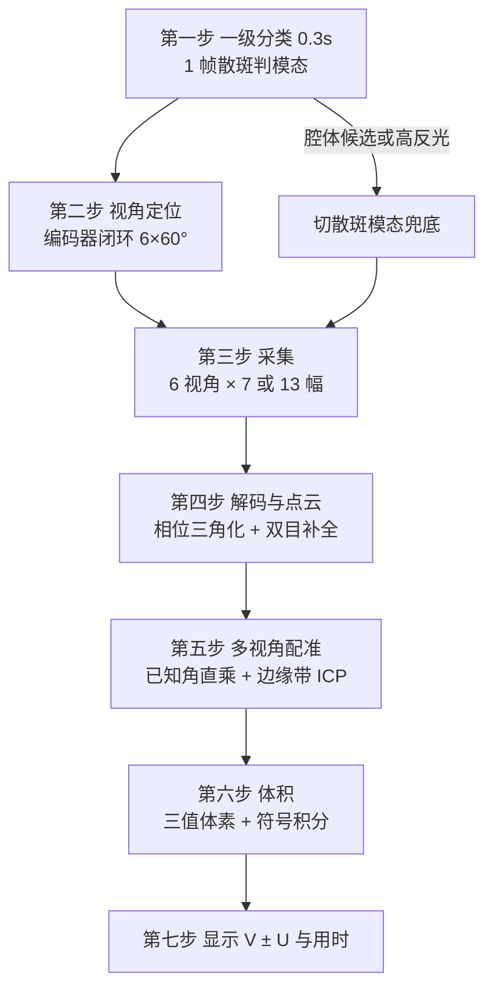

# structured-light-volumetry

双目相机 + 面结构光的三维点云体积测量方案，配套可复现的参数计算脚本与文档批处理工具。

面向全国大学生光电设计竞赛（实物赛）赛题 2「复杂目标物体体积测量」的备赛工作，本仓库只放**方法论、可复现脚本与脱敏后的设计说明**，不放原始方案文件、赛题通知原文与第三方素材。

## 这个仓库解决什么问题

现场给定一批未知目标件（含曲面、台阶、凹槽、通孔），在 60 秒内全自动输出体积。难点不在"把点云画好看"，而在三件事：

1. **看不见的面怎么处理**——支撑面、腔体开口、遮挡盲区三类空缺的误差方向相反，混用会互相掩盖；
2. **任意姿态下体积怎么算**——不能预设目标平放，算法须姿态无关；
3. **误差从哪来、能否复现**——体积误差要能拆到标定、相位、量化三项。

本仓库的核心主张：用**可见性驱动的三值体素（occupied / free / unknown）+ TSDF 融合 → 水密等值面 → 符号体积积分**作为主算法，把"规则约束"变成"几何标注"，而不是事后扣面积。

## 目录

```
docs/
  01-技术方案摘要.md      系统构成、三方法分型、核心设计决策
  02-测量流程与分支.md     七步流程、两级分类判据、失败降级树
  03-误差与验收.md        δ 误差链、验收门限、V±U 输出口径
  04-合规自查.md         赛题规则的逐条对照与不确定性说明
  05-学习资源.md         结构光方向的学习路径（第三方链接，仅索引）
calc/
  volume_budget.py       δ、ΔV/V、体素内存、薄壁门槛、时序预算计算器
tools/
  docx_batch_patch.py    Word 批量替换工具（含占用时安全写入与校验）
  doc_outline.py          导出 docx 标题与表格清单，用于同步文档摘要
validation/
  standard_parts_template.csv   标准件复核记录模板
  analyze_validation.py         均值/标准差/最大偏差/P95/漂移统计
tests/
  test_calc.py
```

## 快速上手

```bash
python calc/volume_budget.py --all
python calc/volume_budget.py --delta 0.42 --radius 0.05
python validation/analyze_validation.py validation/standard_parts_template.csv
python tools/doc_outline.py 你的方案.docx
```

`calc` 与 `validation` 只依赖标准库；`tools` 需要 `python-docx`。

## 核心参数（一页速查）

| 项目 | 取值 | 说明 |
|---|---|---|
| 表面点综合定位误差 δ | 0.42 mm | 标定、相位噪声、三维定位、体素尺寸按方和根合成 |
| 体积误差一阶近似 | ΔV/V ≈ 3δ/R | 由散度定理导出，R 为等效半径 |
| R=5 cm 时体积影响 | ≈2.5% | δ 上浮到 0.6 mm 时为 3.6%，仍在对外 5% 内 |
| 体素尺寸 | 0.5 mm（≈400³） | 自适应细化到 0.3 mm（≈667³） |
| TSDF 截断 τ | 3 体素 = 1.5 mm | 双向射线会把薄壁削薄 |
| 计入体积的壁厚下限 | 6 体素 = 3 mm | 细化后降至 1.8 mm |
| 转台到位精度 | ≤0.1° | 5 cm 半径处端点位移 0.09 mm |
| 单件名义时序 | 19.7 s | 编码位数上修 23.8 s，含一次重采约 26.1 s（方案文档按含调度余量记 27.5 s） |
| 对外承诺 | 单件 P95 < 55 s，体积误差 < 5% | 内部目标 < 2% |

## 七步流程（图）



## 状态与边界

- 方案处于备赛迭代期，`docs/` 中的数值均为**设计目标**，除已注明"实测"者外未经实测。
- 赛题规则的解释以组委会正式通知与书面答复为准；本仓库的合规自查仅代表队伍理解，不构成官方解释。
- 不含：原始 `.docx` 方案、赛题通知 PDF、答辩材料、任何第三方文章截图或转载内容。
- 不采用任何商用三维扫描仪、成套点云输出模块；重建与体积计算全部自研。

## 许可证

代码 MIT；`docs/` 采用 CC BY 4.0。第三方链接仅作索引，版权归原作者。
