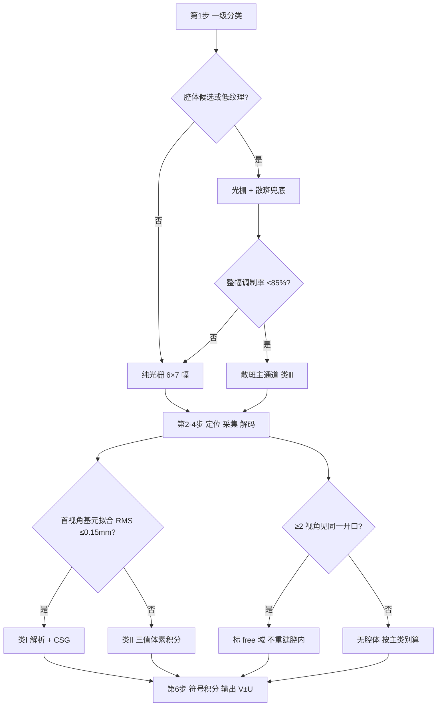

# 测量流程与分支

单件全自动流程，七步，名义 19.7 s。

## 1 七步

| 步 | 名称 | 耗时 | 做什么 | 判据/输出 |
|---|---|---|---|---|
| 1 | 一级分类 | 0.3 s | 投 1 帧散斑，双相机同步曝光 | 只输出「模态 + 候选标记」，不输出类别 |
| 2 | 视角定位 | 1.5 s | 6 个 60° 视角，每次 250 ms（转 150 + 稳定 50 + 编码器校验 50） | 到位误差 ≤0.1° |
| 3 | 采集 | 4.8 s | 7 幅/视角 × 6 视角 = 42 幅，单幅约 114 ms | 硬件外触发，帧齐全 |
| 4 | 解码与点云 | 5.4 s | 相位 3.6 s + 双目补全 1.8 s | 剔除低置信度像素，输出带来源标签的点云 |
| 5 | 配准融合 | 0.2 s | 已知角矩阵直乘 + 边缘带 ICP + 闭环校验 | 首末视角一致性 |
| 6 | 体积 | 3.5 s | 二级分类 → 三值体素 → 等值面 → 符号积分 | 网格自检通过 |
| 7 | 显示 | — | 输出 V ± U 与用时 | 计时终点 |

## 2 为什么第 1 步不分类别

一级只看单帧散斑，而「换视角是否消失」单帧不可知。若一级声称能判腔体，就必须依赖全量重建结果——构成循环论证。因此：

- 一级只决定**投什么图案**（光栅 / 光栅 + 散斑 / 散斑主通道）；
- 类别判定放在二级（首视角点云生成后），由基元拟合残差与调制率决定体积算法。

带通孔的圆柱是这条规则的反例证明：孔轴正对相机时，内壁整圈受光、阴影不明显，一级可能漏检。孔的确认必须交给「≥2 视角观测到同一开口」。

## 3 两级判据

| 级别 | 判据 | 阈值 | 作用 |
|---|---|---|---|
| 一级（编码前） | 单帧连续阴影带/自遮挡边界与轮廓相交且占比超阈值 | 初值 1% | 判腔体候选、光栅失效风险 |
| 一级 | 低纹理像素占比 | 待标定 | 判散斑兜底 |
| 二级（首视角） | 有效调制像素占比 | ≥85%（初值） | 判光栅数据是否有效 |
| 二级 | 深度跳变像素占比 | 赛前混淆矩阵确定 | 判类Ⅱ 候选 |
| 二级 | 基元拟合 RMS | ≤0.15 mm 且基元数 ≤8 | 判类Ⅰ |
| 二级（融合后） | 同一开口在 ≥2 视角可见 | — | 确认类Ⅲ 并封口 |

判定优先级固定为「先定性（判空腔）→ 再定量（解析或积分）→ 后校正」。原因是误差方向不对称：真腔体误判为类Ⅱ 会把腔内空气算进体积（多算），无腔体误判为类Ⅲ 则找不到开口、不封口（几乎无副作用）。所以保守方向是**优先怀疑有腔体**。

## 4 分支树

## 5 混合体处置

| 混合体 | 归属 | 处置 |
|---|---|---|
| 带通孔圆柱 | 类Ⅰ + 类Ⅲ | 解析主体 + CSG 圆柱差扣孔；孔壁点云不足或孔非圆时整件退类Ⅱ |
| 带凹槽立方体 | 类Ⅰ + 类Ⅲ | 主体长方体解析，凹槽按 CSG 差扣除 |
| 球冠 + 台阶 | 类Ⅰ + 类Ⅱ | 球冠解析、台阶积分，同一坐标系融合 |
| 斜面 + 盲孔 | 类Ⅱ + 类Ⅲ | 斜面积分，盲孔标 free |
| L 形/凹形组合 | 类Ⅰ（两长方体并/差）；含曲面则整件类Ⅱ | 布尔求体积并扣交叠；含曲面时解析仅作交叉校验 |

跨类求和的口径：默认「主类别整件计算、次类别解析作交叉校验」；确需分区域相加时，必须用同一坐标系下的分割平面切分，接缝两侧各自闭合，接缝面积不计入任一侧。

## 6 失败降级

| 故障 | 检测 | 处置 |
|---|---|---|
| 曝光/采集失败 | 对比度低或丢帧 | 重曝或重采一次（计入最坏路径） |
| 相位失效 | 置信度或遮挡占比超阈值 | 切散斑或补拍视角 |
| 分类歧义 | 置信度低 | 先按类Ⅲ 判空腔，无腔再定量 |
| 网格异常 | unknown 占比超阈值、边界边非零、法向不一致、体积非正 | 标记精度降级，不输出 |
| 薄壁不足 | 最小局部壁厚 <6 体素 | 先细化到 0.3 mm，仍不足则标记降级 |
| 预判超时 | 关键步骤失败 | 尽早报「测量未完成」，由队伍申请重启（系统不自行重启） |

最坏路径：编码位数上修至 13 幅 → 采集 8.9 s、全流程 23.8 s；叠加一次重采 → 27.5 s。

## 7 三条不变式

这三条是设计的自检底线，任何改动都不能破坏：

1. **编码前不依赖重建**——凡「前置」判据必须单帧可得。
2. **体积只算一次**——空腔封口只做标注先验与校验，不参与面积扣减，避免重复扣除。
3. **未知不填且误差方向可判**——`unknown` 域要么保守计入、要么标记降级，不允许静默填成实体；每次降级都记录误差偏大还是偏小。
